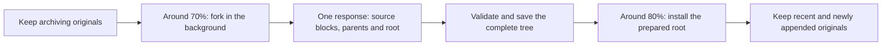

<h1 align="center">SuperLcm</h1>

<b>Four harnesses. One local conversation archive.</b> Keep every original. Recall any detail. Continue in another harness.

<b>English</b> · <a href="README.zh-CN.md">中文</a>

SuperLcm gives **Claude Code, Codex, Pi and dsh harness** a shared conversation archive on your own computer. Original records stay available word for word; layered summaries help you find what matters. Switch tools and continue the same task with one short handoff, then read any earlier detail directly from its source.

This README describes the current `main` branch. The background-branch changes have not yet been published as an npm package; [run from a checkout](#quick-start-from-a-checkout) to try them. Earlier changes are in the [changelog](CHANGELOG.md).

## Four harnesses, one archive

| Harness | Archive, summaries and continuation | Compaction integration | How to connect |
|---|---|---|---|
| Claude Code | Supported | Native compaction by default; optional SuperLcm takeover | Claude plugin or console |
| Codex | Supported | Native host compaction | Console: MCP tools and capture hooks |
| Pi | Supported | Native by default; optional SuperLcm takeover | Console: auto-discovered extension |
| dsh harness | Supported | Native compaction by default; optional SuperLcm takeover | Console: connect globally; main-model branches by default |

All four connections use **main-model background branches** by default. The branch inherits the active model and account and returns a complete tree in one response: granular source summaries, parent summaries and a continuation root. Explicit independent API configurations and “off” remain unchanged. In-conversation summary-writing tools have been retired.

The console navigation is **Conversations → Tools → Compression → Settings**. Each tool card selects the summary method; the Compression page configures Claude Code, Pi and DSH takeover. A replacement ratio always starts preparing 10 percentage points earlier: 50% replacement means 40% preparation. Default: 80%/70%. Enable “Allow another model” to choose from that harness’s native model catalog; the chat model stays unchanged. Around 70% of a known context budget, background preparation starts. Pi and DSH can install the prepared root around 80%, retaining recent and newly appended originals. Codex retains native compaction. Claude uses a percentage of its native capacity; legacy absolute thresholds remain compatible until a new ratio is saved. Unknown context capacity never triggers a speculative automatic branch.

Claude Code, Pi and DSH share the same Compression controls: takeover, replacement ratio, background model and recent originals (20K / 40K / 80K or custom 5K–200K). Retention targets shrink to half the current dialogue when necessary; complete turns and tool groups stay intact. Summary granularity and tree fanout are configured once under Settings, including for the live DSH engine. Changes invalidate pending preparations before reuse. Toggles and presets save immediately; custom values save beside their inputs. Model choices have their own save action.

Source granularity defaults to about 20,000 estimated tokens, with four adjacent children per parent. Every level is requested in the same response and atomically saved after source and completeness checks. Cache hits are measured from provider usage, never guaranteed. See [architecture and verification](docs/MAIN-FORK.md).

Start with the [installation package](docs/RELEASE.md), run `superlcm web`, and choose your tool under **Tools**. Claude Code users can also [install the Claude plugin](#install-as-a-claude-plugin) and open `/superlcm:console`. The DSH plugin is bundled with SuperLcm: connect once globally and reload dsh harness to see SuperLcm under Plugins. No separate dsh-superlcm installation is needed; see [dsh harness setup](docs/DSH.md).

## Move a whole conversation, summaries and all, into another tool

<picture><source media="(prefers-color-scheme: dark)" srcset="docs/images/handoff-en-dark.gif"></picture>

- **Pick up exactly where you stopped.** Out of quota, rate-limited, or want a second model's opinion: say `Continue #6e94e via SuperLcm` in the other tool and the task continues.
- **No retelling, no giant paste.** `lcm_continue` hands over the layered outline and the latest messages, so the new agent starts with a small, focused context instead of the whole transcript.
- **Every detail still one call away.** The whole conversation stays in the archive. When an early decision matters, the new agent reads that record word for word with `lcm_read`.
- **Any direction, back and forth.** Claude Code, Codex, Pi and dsh harness all read and write the same archive, and the continued work is archived too, so the task can be handed back the same way.

## One background branch, one complete tree

For Pi and dsh with the default 80% takeover setting:

Before the normal preparation point, SuperLcm archives originals. At preparation, it fixes a safe older range and plans the whole tree. One model request returns all source summaries and their parent summaries together. **A 20K-token block describes source granularity; it is not a separate model call.** The main conversation continues during preparation, and replacement reads the saved result.

“One response” means one successful preparation task. A later task can prepare a newly eligible range; failed or invalidated work can be retried. Capacity protection can start preparation earlier. With takeover off, summaries stay available for archive lookup and the host manages its own context. Explicit independent API mode keeps its separate background batch writer. Cache usage follows provider receipts.

## Optional compaction takeover for Claude Code

Claude Code takeover uses its configured replacement threshold, 300K tokens by default, with preparation scheduled before that threshold. The latest 40K tokens stay verbatim by default, and complete originals remain available. Branch mode only reads prepared summaries at replacement; missing safe coverage or boundaries return control to native Claude compaction.

Takeover is off by default. Enable it under **Tools → Optional context compaction → Claude Code**. The Claude plugin provides capture hooks, four recall tools, the compaction module and `/superlcm:console`. The module requires Claude Code 2.1.286+; the console reports local capabilities.

## Shorter context, preserved originals

A summary is a guide to the archive. When an old deployment port or decision matters, the agent can search with `lcm_find`, inspect the hierarchy with `lcm_outline`, and read the exact original with `lcm_read`. Losing a detail from a summary does not delete that detail from the archive.

## How it works

**Every turn is saved as it happens.** Your messages, the agent's replies and its tool calls are archived from each harness's transcript or native event stream. Original files or complete event records are retained and indexed for source-checked reads. Each record gets a number, so it can be cited later like a page in a ledger. The archive stays on your computer; summary generation uses the writer you select.

<picture><source media="(prefers-color-scheme: dark)" srcset="docs/images/fig1-en-dark.png"></picture>

**Summaries in layers, each one pointing at its pages.** A run of messages (about 20,000 estimated source tokens by default, adjustable) becomes a summary; the plugin plans parents with four children by default. All source summaries and parents arrive in the same background response. The top reads like a table of contents for the whole conversation, and every entry carries the record numbers it came from. Summaries locate earlier history; exact details and consequential decisions can be checked against numbered source records.

<picture><source media="(prefers-color-scheme: dark)" srcset="docs/images/fig2-en-dark.png"></picture>

**The agent reads the original before it answers.** After a compaction the agent is told where the full record lives, and its lookup tools search summaries and original text (Chinese and English), open the outline, and read exact records checked against the source transcript.

<picture><source media="(prefers-color-scheme: dark)" srcset="docs/images/fig3-en-dark.png"></picture>

## Who writes the summaries

The default is **main-model background branch**, using the current conversation model and account. Summary preparation and compaction takeover have independent controls. Claude Code, Codex, Pi and dsh all support background summaries; Claude Code, Pi and dsh additionally offer optional takeover. An independent API model remains an advanced choice, and summaries can be turned off.

Use the tool card to choose the writer. Open **Compression** to configure ratios and optional native background models. Importing historical sessions calls no model. Disconnecting preserves stored originals and summaries; reload existing sessions afterwards.

## Compaction vs. an archive

| | Ordinary compaction | SuperLcm |
|---|---|---|
| The original words | Out of the agent's reach after compaction | Kept in full, readable by record number |
| Summary shape | One flat summary, shorter each time | Layers like a book, each pointing at its pages |
| A detail from 300 turns ago | Survives only if the summary kept it | Found by search, quoted exactly |
| When the context fills up (Claude Code, optional takeover) | Wait while a model summarizes | Swap ready summaries at once, otherwise use native compaction |
| Continuing in another tool | Start over and re-explain | One sentence, with outline and recent messages |
| Where it lives | — | A file on your computer |

## Install as a Claude plugin

In Claude Code:

    /plugin marketplace add yu381792/superlcm
    /plugin install superlcm@superlcm

The plugin brings everything listed above for Claude Code; to use the compaction takeover, open the console and turn it on under Tools → Optional context compaction. `/superlcm:console` opens the console, where Codex, Pi and dsh harness are connected to the same archive. It runs wherever Claude can start local programs (Claude Code, and Cowork on your own computer), not in claude.ai web or mobile chat. Needs Node.js 22.16 or newer on PATH; an older `node` hands over to a newer one if one is installed.

Plugin updates replace the plugin folder, so tools connected from the plugin's console are pointed at a fixed entry file in the SuperLcm folder (`~/.superlcm-claude/superlcm.js`) that follows updates. If Claude Code was connected from the console before, the older hooks in Claude's settings stay quiet once the plugin is enabled, and the console's Claude card offers to remove them and the older `superlcm` MCP entry (backed up first). The same card installs and updates the plugin.

## Quick start (from a checkout)

    node src/cli.js web

Open `http://127.0.0.1:8791/` (no login; it only listens on this computer), then:

1. **工具 (Tools)** — connect a harness and choose the summary method. The default branch follows the current model and account. Use **Compression** to configure Claude Code, Pi or dsh takeover, preparation ratios and optional native background models. Reload existing host sessions after changing integration code.
2. **对话 (Conversations)** — browse, search and read stored conversations and their summary trees. Use **换个工具继续** to hand a task to another tool.
3. **设置 (Settings)** — tune source granularity and parent width, and manage advanced API models.

Terminal equivalents: `superlcm setup dsh --apply`, `node src/cli.js setup codex --apply`, `node src/cli.js setup pi --apply`, `node src/cli.js summarize <conversation> --backend main-fork` (Claude Code and Codex native branches).

Pi session files are append-only and are indexed byte for byte, all branches included.

## MCP tools

| Tool | Purpose |
|---|---|
| `lcm_continue` | Hand over another conversation: top-level outline + recent messages + how to dig deeper |
| `lcm_find` | Find conversations by `#code`, name or ID, and search summaries and originals |
| `lcm_outline` | Expand the summary tree one level at a time |
| `lcm_read` | Read exact original records by number |

All four MCP tools are read-only. Summary generation and persistence belong to the background integration, separate from recall.

## More

- [Setup, security and limitations](docs/SETUP.md)
- [Console behavior and tests](docs/CONSOLE.md)
- [Privacy](PRIVACY.md)
- [Changelog](CHANGELOG.md) · [Contributing](CONTRIBUTING.md) · [Contributions](CLA.md) · [Security](SECURITY.md)
- License: [MIT](LICENSE). Copyright 2026 ygc381792 and contributors. Free to use, modify and redistribute, including commercially; keep the copyright notice.

Claude, Claude Code, Codex and Pi names and logos belong to their respective owners and are used only to identify compatible tools. SuperLcm is an independent project and is not affiliated with or endorsed by them.

摘要语言和指令隔离修复见 [新版说明](docs/SUMMARY-QUALITY-0.5.24.md)。

The DSH plugin ships in the main package. See [DSH setup and standalone migration](docs/DSH.md).

Claude 接管的真实宿主验证与社区修复见 [Claude 接管可靠性说明](docs/CLAUDE-RELIABILITY.md)。

主动审查与发布前故障验证见 [发布验证说明](docs/RELEASE-VERIFICATION.md)。发布者运行 `npm run verify:release`，包含实际安装包、运行时和失败场景；两版共用修复在发布前核对一致。

可靠性测试：`npm run test:reliability`；完整发布检查：`npm run verify:release`。覆盖范围见 [连续使用与故障恢复测试台](docs/RELIABILITY-LAB.md)。
